# Feature Dependencies

This diagram shows the dependencies between features in the Bull Bitcoin Mobile application. It helps visualize the dependency graph and ensures there are no cyclic dependencies.

**Diagram Type**: This is a **Package Dependency Diagram** (also known as Module Dependency Graph or Component Dependency Diagram in UML).

## Module Dependency Graph

```mermaid
graph TB
    %% Core infrastructure
    CORE[Core<br/>---<br/>Database, Secure Storage,<br/>API Clients, Tor Adapters, UI Kit,<br/>DI & Router setup,<br/>PIN encrypted storage,<br/>Domain Primitives/Value Objects]
    PRIMITIVES[Primitives Package]
    BULL_LOGGER[Bull Logger Package<br/>Logger, diagnostics, log files]
    BULL_PAYJOIN[Bull Payjoin Package<br/>Public contract]
    BULL_PRICER[Bull Pricer Package<br/>Bitcoin price and history]
    ROBOSATS[RoboSats Package<br/>Robot identity, coordinator client, robot on a coordinator, taker's order, maker's make and pause calls, payout and escrow release calls, on-chain address check, trade chat, chat over Nostr, rating of the coordinator over Nostr]
    SCREEN_PRIVACY[Screen Privacy Package<br/>Capture protection]

    %% Feature modules
    SETTINGS[Settings]
    LOGS[Logs<br/>Workspace Feature]
    P2P[P2P<br/>Workspace Feature]
    P2P_WALLET[P2P Wallet<br/>Troc]
    ELECTRUM_SETTINGS[Electrum Settings]
    TOR_SETTINGS[Tor Settings]
    RECOVERBULL[RecoverBull]
    TOR[Tor<br/>Workspace Package]
    PIN_CODE[Pin Code]
    LABELS[Labels]
    SECRETS[Secrets Package<br/>Custody: storage, derivation, signing, backup]
    HW_WALLETS[Hardware Wallets]
    BTC_PRICE[Bitcoin Price]
    NETWORK[Network]
    BIP85[BIP85]
    FEES[Fees]
    WALLETS[Wallets]
    EXCHANGE[Exchange]
    EXCHANGE_SETTINGS[Exchange Settings]
    EXCHANGE_SUPPORT_CHAT[Exchange Support Chat]
    APP_STARTUP[App Startup]
    UTXO_MGMT[UTXO Management]
    ADDRESS_MGMT[Address Management]
    RECIPIENTS[Recipients]
    FUNDING[Funding]
    BACKUPS[Backups]
    SWAPS[Swaps]
    WITHDRAWAL[Withdrawal]
    STATUS[Status]
    SEND[Send]
    RECEIVE[Receive]
    TRANSFER[Transfer]
    TX_HISTORY[Transaction History]
    REPLACE_BY_FEE[Replace By Fee]
    BG_TASKS[Background Tasks]
    DCA[DCA]
    DEFAULT_WALLETS[Default Wallets]
    LIMIT_ORDERS[Limit Orders]
    SELL[Sell]
    PAY[Pay]
    BUY[Buy]
    COINS[Coins / UTXOs]
    ANNOUNCEMENTS[Announcements]
    CONSOLIDATION[Consolidation]
    ALL_SEED_VIEW[All Seed View]
    APP_UNLOCK[App Unlock]
    AUTOSWAP[Autoswap]
    SP[Silent Payments]
    AUTOBUY[AutoBuy]

    %% Dependencies to Core (all features depend on Core, but showing it explicitly would clutter the diagram)
    %% Instead, we note this in the documentation below

    %% Extracted package dependencies
    CORE --> PRIMITIVES
    CORE --> BULL_LOGGER
    LOGS --> BULL_LOGGER
    LOGS --> PRIMITIVES
    LOGS --> BULL_UI
    SETTINGS --> LOGS
    ROBOSATS --> PRIMITIVES
    P2P --> ROBOSATS
    P2P --> TOR
    P2P --> PRIMITIVES
    P2P --> BULL_LOGGER
    P2P --> BULL_UI
    P2P --> SECRETS
    P2P --> SCREEN_PRIVACY
    P2P_WALLET --> P2P
    P2P_WALLET --> SWAPS
    P2P_WALLET --> WALLETS
    P2P_WALLET --> BULL_PRICER
    CORE --> BULL_PAYJOIN
    BULL_PAYJOIN --> PRIMITIVES
    CORE --> BULL_PRICER
    BULL_PRICER --> PRIMITIVES
    BTC_PRICE --> BULL_PRICER
    BUY --> BULL_PRICER
    PAY --> BULL_PRICER
    RECEIVE --> BULL_PRICER
    SELL --> BULL_PRICER
    SEND --> BULL_PRICER
    STATUS --> BULL_PRICER
    SWAPS --> BULL_PRICER

    %% Feature-to-feature dependencies (extracted from draw.io diagram)
    ADDRESS_MGMT --> LABELS
    ALL_SEED_VIEW --> APP_UNLOCK
    ALL_SEED_VIEW --> SECRETS
    ANNOUNCEMENTS --> SETTINGS
    ANNOUNCEMENTS --> SWAPS
    APP_STARTUP --> WALLETS
    APP_STARTUP --> SECRETS
    APP_STARTUP --> LOGS
    AUTOSWAP --> SWAPS
    APP_STARTUP --> TOR
    AUTOSWAP --> TRANSFER
    AUTOBUY --> DEFAULT_WALLETS
    BIP85 --> SECRETS
    BIP85 --> SETTINGS
    BACKUPS --> BIP85
    BACKUPS --> RECOVERBULL
    BACKUPS --> TOR
    BACKUPS --> WALLETS
    BTC_PRICE --> SETTINGS
    BUY --> EXCHANGE
    BUY --> RECEIVE
    BUY --> BULL_PAYJOIN
    BUY --> TX_HISTORY
    COINS --> UTXO_MGMT
    COINS --> LABELS
    COINS --> WALLETS
    DCA --> RECEIVE
    SETTINGS --> DEFAULT_WALLETS
    SETTINGS --> EXCHANGE
    SETTINGS --> EXCHANGE_SETTINGS
    EXCHANGE_SETTINGS --> EXCHANGE
    EXCHANGE --> AUTOBUY
    LIMIT_ORDERS --> EXCHANGE
    EXCHANGE --> EXCHANGE_SUPPORT_CHAT
    EXCHANGE --> BTC_PRICE
    EXCHANGE --> DCA
    EXCHANGE --> FUNDING
    EXCHANGE --> TX_HISTORY
    EXCHANGE --> WITHDRAWAL
    SETTINGS --> EXCHANGE_SUPPORT_CHAT
    WALLETS --> EXCHANGE_SUPPORT_CHAT
    SWAPS --> EXCHANGE_SUPPORT_CHAT
    REPLACE_BY_FEE --> EXCHANGE_SUPPORT_CHAT
    DCA --> EXCHANGE
    PAY --> EXCHANGE
    TX_HISTORY --> EXCHANGE
    WALLETS --> EXCHANGE
    WITHDRAWAL --> EXCHANGE
    LIMIT_ORDERS --> DEFAULT_WALLETS
    LIMIT_ORDERS --> FUNDING
    FEES --> NETWORK
    FUNDING --> EXCHANGE
    FUNDING --> RECIPIENTS
    HW_WALLETS --> CORE
    LABELS --> CORE
    PAY --> RECIPIENTS
    PAY --> BULL_PAYJOIN
    PIN_CODE --> CORE
    RECEIVE --> BULL_PAYJOIN
    RECEIVE --> SETTINGS
    RECEIVE --> SWAPS
    RECEIVE --> TX_HISTORY
    RECIPIENTS --> EXCHANGE
    SELL --> EXCHANGE
    SELL --> RECIPIENTS
    SELL --> BULL_PAYJOIN
    SELL --> TX_HISTORY
    SEND --> CONSOLIDATION
    SEND --> FEES
    SEND --> NETWORK
    SEND --> BULL_PAYJOIN
    SEND --> SP
    SEND --> SWAPS
    SEND --> TX_HISTORY
    SEND --> UTXO_MGMT
    SEND --> WALLETS
    SETTINGS --> CORE
    SETTINGS --> BULL_PAYJOIN
    SETTINGS --> RECOVERBULL
    SETTINGS --> TOR_SETTINGS
    TOR_SETTINGS --> TOR
    STATUS --> BULL_PAYJOIN
    STATUS --> TOR
    SWAPS --> BULL_PAYJOIN
    SWAPS --> SECRETS
    SWAPS --> EXCHANGE
    SWAPS --> LABELS
    SETTINGS --> SP
    WALLETS --> SP
    SWAPS --> UTXO_MGMT
    CORE --> TOR
    ELECTRUM_SETTINGS --> TOR
    WALLETS --> TOR
    WALLETS --> ELECTRUM_SETTINGS
    RECOVERBULL --> TOR
    RECOVERBULL --> SECRETS
    TRANSFER --> CONSOLIDATION
    TRANSFER --> SEND
    TRANSFER --> RECEIVE
    TX_HISTORY --> BULL_PAYJOIN
    TX_HISTORY --> SWAPS
    TX_HISTORY --> WALLETS
    UTXO_MGMT --> LABELS
    UTXO_MGMT --> WALLETS
    WALLETS --> BIP85
    WALLETS --> CONSOLIDATION
    WALLETS --> HW_WALLETS
    WALLETS --> NETWORK
    WALLETS --> SECRETS
    SP --> SECRETS
    WALLETS --> SETTINGS
    WALLETS --> SWAPS
    WITHDRAWAL --> RECIPIENTS

    %% Styling
    classDef coreStyle fill:#2d3748,stroke:#4a5568,stroke-width:3px,color:#fff
    classDef packageStyle fill:#234e52,stroke:#319795,stroke-width:2px,color:#e6fffa
    classDef featureStyle fill:#1a202c,stroke:#2d3748,stroke-width:2px,color:#e2e8f0

    class CORE coreStyle
    class SECRETS,PRIMITIVES,BULL_PAYJOIN,BULL_PRICER,ROBOSATS,TOR,SCREEN_PRIVACY packageStyle
    class SETTINGS,P2P,P2P_WALLET,PIN_CODE,LABELS,HW_WALLETS,BTC_PRICE,NETWORK,BIP85,FEES,WALLETS,EXCHANGE,EXCHANGE_SETTINGS,EXCHANGE_SUPPORT_CHAT,APP_STARTUP,UTXO_MGMT,ADDRESS_MGMT,RECIPIENTS,FUNDING,BACKUPS,SWAPS,WITHDRAWAL,STATUS,SEND,RECEIVE,TRANSFER,TX_HISTORY,REPLACE_BY_FEE,BG_TASKS,AUTOSWAP,AUTOBUY,DCA,DEFAULT_WALLETS,LIMIT_ORDERS,SELL,PAY,BUY,COINS,ANNOUNCEMENTS,CONSOLIDATION,ALL_SEED_VIEW,APP_UNLOCK,SP featureStyle
```

## About Package Dependency Diagrams

### What This Diagram Shows

- **Modules/Packages**: Each box represents a self-contained feature/package
- **Dependencies**: Arrows show "depends on" relationships (A → B means "A depends on B")
- **Direction**: Dependencies flow from dependent to dependency (not data flow)

### Standard Information in Package Diagrams

1. **Module Names**: Clear identification of each package/feature
2. **Dependency Direction**: Arrows indicating which module depends on which
3. **Optional Elements** (can be added):
   - Dependency type labels (e.g., "uses facade", "imports types")
   - Stereotypes like `<<core>>`, `<<feature>>`, `<<infrastructure>>`
   - Access modifiers (public/internal APIs)
   - Dependency cardinality (required vs optional)

## Dependency Rules

1. **No Cyclic Dependencies**: Features must not create circular dependency chains
2. **Core Independence**: Core must not depend on any feature
3. **Feature Isolation**: Features should communicate through well-defined facades/interfaces
4. **Layered Dependencies**: Dependencies flow one way — `shell → features → packages` across modules, and `ui → presentation → domain → data` within a feature. Under the melos migration each `lib/core/<domain>` becomes a `packages/<domain>` and these turn into compile-time boundaries. See [ARCHITECTURE.md](ARCHITECTURE.md).

## Core Dependencies

**Important**: All features implicitly depend on Core for foundational services. These dependencies are not shown in the diagram to reduce visual clutter.

### What Core Provides

1. **Infrastructure Services**:

   - Database (Drift/SQLite)
   - Secure Storage instance (Flutter Secure Storage)
   - API Clients (REST/GraphQL clients)
   - Embedded Onion adapter with isolated RecoverBull and Bitcoin Electrum `.onion` sessions
   - Explicit local SOCKS5 override for Bitcoin Electrum and encrypted backups
   - UI Kit (shared widgets, theme)
   - DI setup and interfaces (Service Locator pattern)
   - Router setup and interfaces (Navigation)
   - PIN encrypted storage

2. **Core Primitives**:
   - Canonical location: `packages/primitives`; compatibility exports remain in `lib/core` during migration.
   - Extracted examples: `Failure`, `Result`, `Fingerprint`, network types, `Outpoint`, `Sats`, and `FeeRate`. Security-domain types such as `Secret` now live in `packages/secrets`, which owns them rather than exposing them as primitives.
   - Shared types used across multiple features, avoiding redundant definitions
   - Immutable, validated value objects that ensure domain integrity

> Migration note: `lib/core` is shared infrastructure (no business logic). Shared *domain* modules that historically landed in `lib/core/<domain>` (e.g. `wallet`) graduate into `packages/<domain>` under the melos workspace — each exposing its repository interfaces + domain types + shared use-cases through a public API, never a bloc or screen. See [ARCHITECTURE.md](ARCHITECTURE.md).

## Key Dependency Patterns

### Central Features (Highly Depended Upon)

- **Core**: Foundation for all features
- **Tor**: `packages/bull_tor` — embedded Onion lifecycle with isolated RecoverBull and Bitcoin Electrum `.onion` sessions, plus provider-agnostic local SOCKS5 verification. Depends on Flutter for app-directory storage and an iOS plugin that excludes Tor state from backups, which are infrastructure-package exceptions in AGENTS.md
- **Wallets**: Used by Send, UTXO Management, Transaction History, Backups, App Startup
- **Secrets** (workspace package): Used by Wallets, BIP85, App Startup, All Seed View, RecoverBull, Swaps, Silent Payments, and P2P for its Garage Keys only
- **Settings**: Used by Wallets, BIP85, Bitcoin Price
- **Recipients**: Used by Pay, Withdrawal
- **UTXO Management**: Used by Send, Swaps, Payjoin

### Leaf Features (Depend on Many, Few Depend on Them)

- **Send**: Depends on Fees, Network, Payjoin, Swaps, UTXO Management, Wallets
- **Receive**: Depends on Payjoin, Swaps
- **Backups**: Depends on BIP85, Tor, Wallets
- **P2P** (workspace feature, Troc): Depends on the RoboSats package for the protocol, on Tor for the transport and on `bull_ui` for its screens (the P2P tab: Tor wait, order book, its depth chart and its map of the orders that have a location, over a world map bundled with the feature, with no tile and no request, order details and the dialog of its coordinator, search of an order by its URL, and since #88 the take of an order as buyer, and since #96 as seller (a buy order: the escrow paid at 6 and 7 from another wallet or, since #97, from this one, « Confirm … received » at 10), in two steps since #119 (the order read by the robot that takes it, its maker's description and fresh figures shown in the order details, then « Continue » and « Done »), and its trade screen); inside the feature, use cases can also make a robot known to a coordinator and read it back, on a Tor session per coordinator and robot, only once the robot is bound to that coordinator (one robot index, one coordinator, kept in the feature's own Drift database `p2p.sqlite`, whose schema 8 (#176) already holds the records of an order made here, which nothing writes yet, whose directory the shell passes to `P2pFeature.setup` with the Garage Key handle, in the foreground composition only), which only the robot panel of the Garage profile calls and which the app-facing facade does not offer; since #177 the feature's domain also knows what a maker asks and what this wallet would pay for it, and since #178 how each answer of a coordinator about an order made here becomes what a screen may show or the wallet may pay (the maker's statuses, its edges, the contracts of each take and the maker's checks); since #179 its use case makes an order on a coordinator for a fresh robot (`/api/info/` and `/api/limits/` read anonymously just before, the make and its terms written before the request, sent once, confirmed only by the robot's read of the order), resolves a make whose answer was lost by reading the robot's active or last order, follows and lists an order made here from its maker's terms, cancels it as its maker, keys the wallet's payout invoice by contract, and orders the coordinators by the reference's lottery for the form's default, none of which a screen calls yet (#181, #182); since #180 « Pay with this wallet » pays an order's maker bond at 0 through the same use case, after a confirmation that compares it with the wallet's own price of a bitcoin (`P2pWalletPort.bitcoinRate`, the owner's rule of 2026-11-17), and the trade screen has the maker's panel of 0, none of it reachable before « Create » (#182); since #181 the create form (the reference's basic form, its coordinators' `/api/info/` and `/api/limits/` read anonymously, the default host by the reference's lottery, the make called from its confirmation, and the chosen coordinator's price compared with the Bull wallet's through the same port, `CheckMakePriceUsecase`, before any robot) exists, built by `P2pRouter.createPage`; since #182 it is reachable (« Create » of the tab while the network has no active trade nor pending make, « Create order » at the top of « Active trades » otherwise, through the route `create`), the trade screen shows the maker's panels of a buy order (« Your order is public » with the figures of the book the tab read, « (x/5) », « Your maker bond is … », « Cancel » at once at 1 and 2, the gap from the creation's rate before « Submit », before the chat and in « Confirm … sent » when the Bull wallet's comparison is not shown, a line under the reference's texts that are false for a maker, 17 and 18 by side, back in the book and a next contract), the pending makes are listed, resolved and set aside in « Active trades » and above the form (`PendingMakesCubit`, the only caller of `MakeOrderUsecase.pendingMakes`, `resolve` and `dismiss`), the book opens an order this device made as its trade, and the same port's price of a bitcoin is compared, for a maker buyer, with the sats of the invoice asked before « Submit » of the payout and, at « fiat sent », with the smaller of the coordinator's figure and the invoice's sats kept in memory for the contract (`CheckPayoutRateUsecase`, `PayoutRateCubit`, `PayoutRateMemory`, the owner's rule of 2026-11-17, information and a warning only, read again at the press when three minutes old); since #183 the form has the reference's advanced options (a range, « Description », « Public Duration », « Escrow/Invoice Timer », « Fidelity Bond Size », the password and the location shown disabled until #189), and the rule compares a range's contract on the amount kept with the contract, nothing while the coordinator shows it with another amount; since #187 the escrow's instance of the same use case pays a maker seller's escrow at 6 and 7, with no ceiling, after a comparison with the Bull wallet's price of the contract's amount (`WalletRateCheck.ofMakerEscrow`, the owner's rule of 2026-11-17, a warning only), only for the contract its confirmation states (`escrowContractOf`) and the trail read again under the payment's lock, whatever the earlier escrows of the order paid from this wallet stand at, the confirmation giving the sats of those not back yet and what will be out with this one, and those the coordinator kept, as the wallet's records of each swap say (`TradePaymentRepository.paymentsOfTrade`, `P2pWalletPort.findPayment`), and a new confirmation asked when more is out under the payment's lock (the owner's decision of 2026-11-19: no lock, an alert); each escrow is recorded and followed under its contract (`followEscrows`), after the trade's end too, and the panel's words for it are #188's, so that no screen pays a maker's escrow before them; since #184 the trade screen pauses a public order made here and makes it public again (« Unpause Order »), one tap, the order read again first and the request sent only when that read shows the status the user saw, never twice, the order shown paused only from a read sent after the request, a cancel tapped meanwhile sent after it (`PauseOrderUsecase`, called by `TradeCubit.pause` only); the trade use cases (#87) take an order as its taker for a fresh robot (in two steps since #119: the order read by that robot, with the maker's description, before the user confirms, which the order details call), follow the trade at the reference client's cadence, cancel it and list the active trades, keeping each trade's record, terms and trail in that database, called only by the cubits of the trade screens (#88: « Take Order » on the order details and on an order public again, the trade screen with its bond panel and cancel, its « Order » tab reading the coordinator's info and, for an order public again, its book, anonymously as the order details do, the « Order » entry of the tab for the active trades; the QR code of the bond drawn with `qr_flutter`, the wallet's own QR package; since #100, « Pay with this wallet » in the trade screen pays the bond, and since #97 the seller's escrow (one instance of the same use case per step), from the Instant payments wallet through `P2pWalletPort`, which only `PayBondFromWalletUsecase` calls, its payment recorded in `trade_payments` (the escrow's step since schema 7; one row per contract and each payment hash once since schema 8, #176) before the wallet is asked, and « Generate Invoice » / « Generate New Address » in the payout panel ask the same port for the wallet's invoice or address, which only `PayoutFromWalletUsecase` calls, and put it in the panel's field); the chat (#93) reads and sends the encrypted chat of a trade through the coordinator's API, each message sent also published over Nostr as the official client does (#94: two NIP-59 gift wraps to the coordinators' relays through the robot's Tor sessions), the peer's public key pinned per trade and kept across a restart with its fingerprints (#139), the order's Nostr keys pinned at the first Nostr copy and kept likewise (part of #159), the messages in memory only, shown in the chat step in a panel protected from screen capture that reads every 5 s while shown, with « Don't trust, verify » and the export as the reference's, in the chat step's « Order options » (#157), over the panel's own cubit; at the end of a successful trade, « Rate your host » asks the coordinator for the token of a rating and publishes the rating of the trade's coordinator over Nostr (#95: one event of kind 31986 to the same relays, through the robot's Tor sessions), called by its own cubit of the trade screen; the payout use case (#90) gives the buyer's Lightning invoice or on-chain address, checked and clear-signed by the robot's key, which a keyring of the trades reads back from the coordinator and unlocks off the UI isolate only while the payout panel holds it or a signature needs it, called by the payout panel of the trade screen (#91: the reference's Lightning and Onchain tabs at 6 and 8, and the failed payout of 15, the invoice or address pasted by the user); the chat step's use case (#95) sends the buyer's « Confirm … sent », « Payment failed? », the seller's « Confirm … received » (#96, the escrow released) and « Open Dispute » once (the dispute not before 18 hours from the chat's end), from a fresh read that still shows the status the user saw, and the cancel use case the collaborative cancel of the chat (ask or accept), called by the trade screen's cubit (the buyer's and the seller's chat step at 9 and 10 with the reference's dialogs, then « Attempting Lightning Payment » at 13 for the buyer and « Trade finished! » at 14, and at 13 and 15 for the seller, with « Rate your trade experience », « Rate your host », the on-chain payment's lines and the trade summary); depends on the Secrets package for the RoboSats Garage Key of each network, whose handle the shell passes to `P2pFeature.setup` in the foreground composition only, and which internal use cases generate, import, read, derive robots from and delete for the Garage of the tab (welcome, wizard, profile, robot navigator, delete, recovery by pasting a key, all on the device; under the navigator of the profile, the robot panel shows the coordinator a robot is bound to and reads it back once Tor is ready, and puts a robot on a coordinator only when the user chooses one with « Select Host » and confirms; for a key pasted, or whose draw could not be recorded, « Select Host » first asks « Robots from elsewhere », once per key and network, which only the user's « I understand » records), and of which the book asks only whether one is stored, for « Search order »; depends on the Screen Privacy package, which protects the whole Garage from capture as the wallet's seed screens are; the PIN re-authentication the profile asks before it shows a stored key is App Unlock's `buildReauthenticationGate`, which the shell lends to `P2pFeature.route` (the feature does not import App Unlock); the shell mounts its tab behind the superuser and dev-mode gate, and no feature depends on it
- **P2P Wallet** (Troc, `lib/features/p2p_wallet`, #100): the wallet's side of the P2P feature's `P2pWalletPort`, which the shell hands to `P2pFeature.setup` in the foreground composition only. Depends on the P2P workspace feature for the port's contract, on Swaps (`SwapFacade`: the quote, and for the payment the creation of the order, the saved payin and its marks, and the reads of the order records) for the swap service, and on Wallets for the Instant Payments wallet's balance and syncs, its refund address, the build, check and signature of the Liquid funding transaction, its broadcast (`BroadcastLiquidTransactionUsecase`, as Autoswap broadcasts) and the wallet's decoder of invoices (the readers and repositories that Pay, Sell, Send and Autoswap use). It pays a checked invoice (#100, W3) from one use case only, `PayCheckedInvoiceUsecase`, and nothing in the app calls the payment yet; for the buyer's payout (#90) it makes a Lightning invoice of the Instant Payments wallet (a receive order at the swap service, `ReceiveWalletInvoiceUsecase`) and gives a new address of the default Bitcoin wallet (`ReceiveWalletAddressUsecase`), which the payout panel's « Generate Invoice » and « Generate New Address » ask through the port; since #180 it depends on the `bull_pricer` package for the wallet's own price of a bitcoin in an order's currency (`ReadWalletRateUsecase` over `Pricer.getIndexPrice`, the price the wallet's home screen reads), which the P2P feature compares a maker bond with before its confirmation and, since #181, the coordinator's price with in the create form; no feature depends on it, and P2P reaches it only through the port

### Exchange-Related Features

- **Buy, Sell, Funding**: All depend on Exchange
- **Recipients**: Depends on Exchange

## Verification

To verify no cyclic dependencies exist, you can:

1. **Manual trace**: Follow any path through the graph - it should never return to a previously visited node
2. **Automated tools**: Use `dart pub deps` or custom dependency analysis scripts
3. **Import analysis**: Review import statements in facade/public API files

## Future Improvements

- Add dependency type labels (e.g., "uses facade", "imports primitives")
- Document which specific APIs each feature exposes
- Add dependency cardinality (required vs optional dependencies)
- Include compile-time vs runtime dependency distinction
- Add layer groupings (ui, presentation, domain, data) per [ARCHITECTURE.md](ARCHITECTURE.md)
