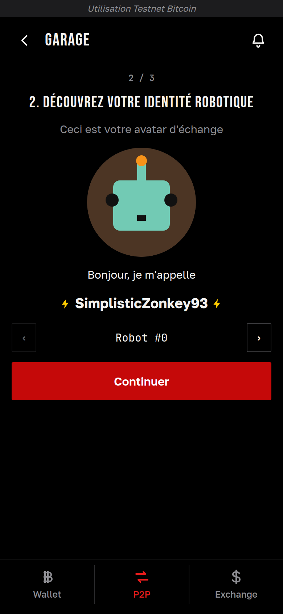
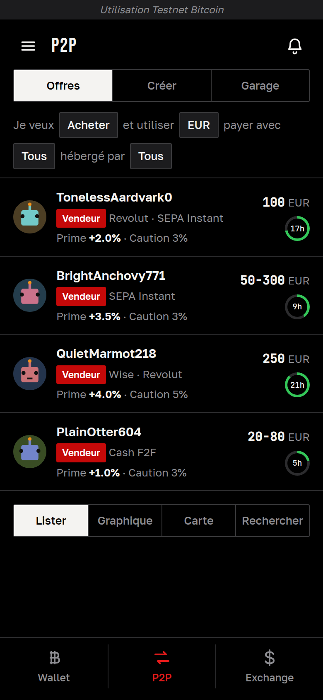
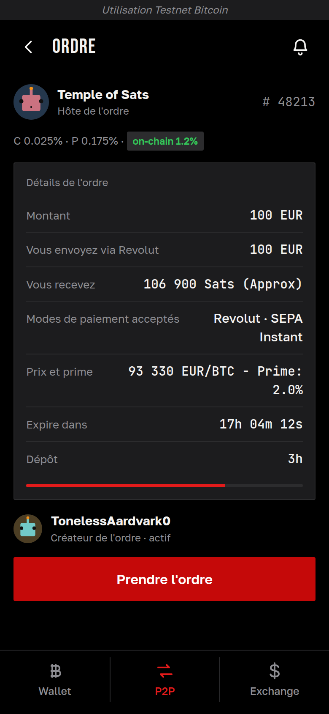
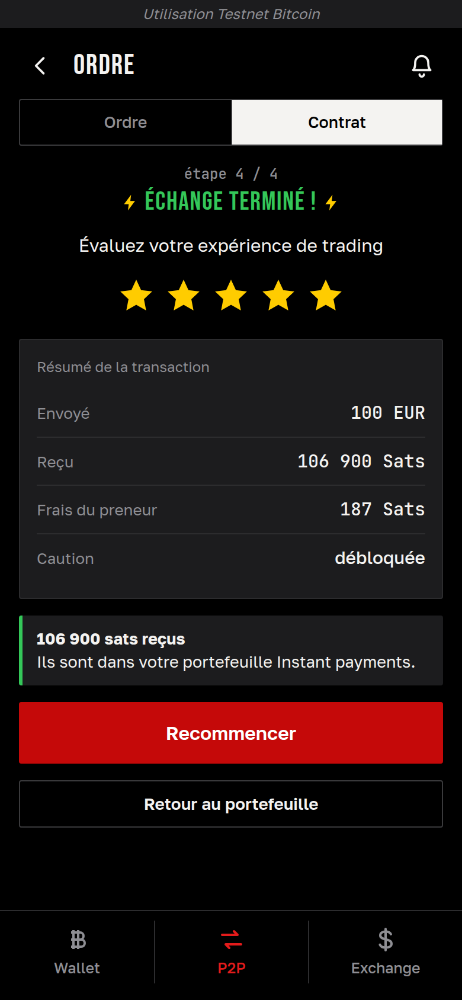
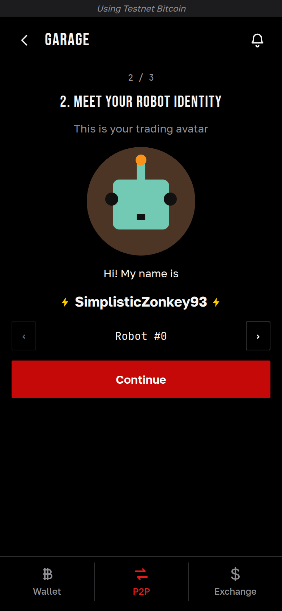
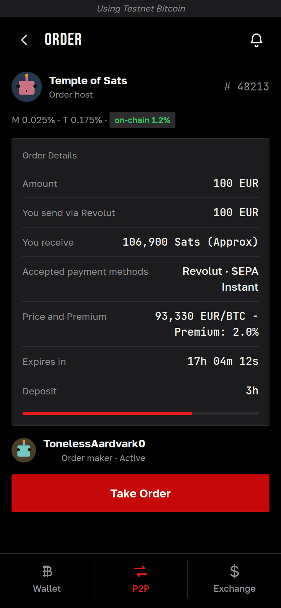
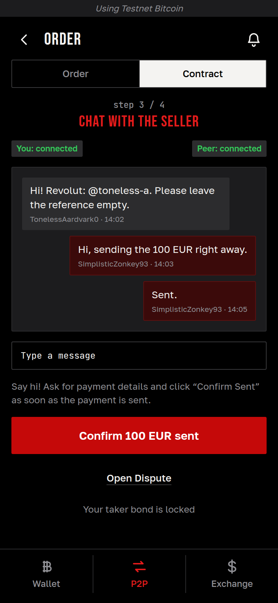
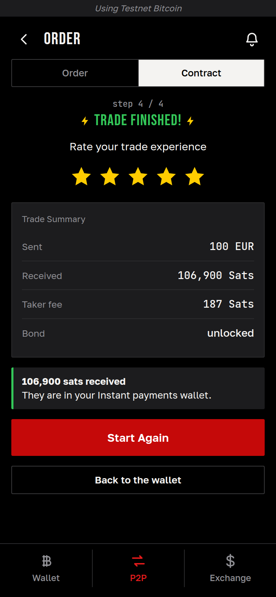

# Troc

> **Prototype en cours de développement. Ne pas utiliser avec des fonds réels.**
> Troc n'est affilié ni à Bull Bitcoin / Satoshi Portal ni à RoboSats. « Troc » est un nom provisoire.

Troc est un fork du portefeuille [Bull Bitcoin Mobile](https://github.com/SatoshiPortal/bullbitcoin-mobile) (Flutter) qui vise à y intégrer un client [RoboSats](https://github.com/RoboSats/robosats) : l'échange de bitcoin de pair à pair, sans compte, via Tor, directement depuis un portefeuille en auto-garde.

*Troc is a fork of Bull Bitcoin Mobile that aims to embed a RoboSats client (peer-to-peer bitcoin exchange over Tor) inside a self-custodial wallet. Early prototype, not affiliated with Bull Bitcoin or RoboSats, do not use with real funds.*

## L'idée

RoboSats permet d'acheter ou de vendre du bitcoin contre de la monnaie fiduciaire, directement entre deux personnes : pas de compte, pas de pièce d'identité, une identité jetable (un « robot ») par échange, et tout le trafic par Tor. Les bitcoins de l'échange et les cautions des deux parties sont bloqués par des factures Lightning « hold » le temps que le paiement se fasse.

Aujourd'hui, il faut deux outils : RoboSats d'un côté (son site dans le navigateur Tor, ou son application), un portefeuille Lightning de l'autre, et des factures à copier de l'un à l'autre à chaque étape.

Troc veut réunir les deux dans une seule application :

- un onglet **P2P** dans le portefeuille, à côté des onglets existants ;
- le **même parcours que RoboSats**, étape par étape et avec les mêmes libellés, habillé comme le reste du portefeuille ;
- les sats achetés arrivent **directement dans le portefeuille**, qui prépare lui-même la facture de réception ;
- la connexion aux coordinateurs RoboSats passe par le **Tor déjà embarqué** dans le portefeuille.

## Aperçu (maquette)

> Ces écrans sont une **maquette** : ils montrent la cible, pas l'application actuelle. Les données sont fictives. Aucun écran P2P n'est encore présent dans l'application.

<table>
  <tr>
    <td align="center"> Un onglet P2P dans le portefeuille</td>
    <td align="center"> Connexion à Tor</td>
    <td align="center"> Un robot : une identité jetable</td>
    <td align="center"> Le carnet d'offres</td>
  </tr>
  <tr>
    <td align="center"> La fiche d'une offre</td>
    <td align="center"> Bloquer la caution</td>
    <td align="center"> Le chat chiffré avec le vendeur</td>
    <td align="center"> Échange terminé</td>
  </tr>
</table>

Quelques précisions sur ce que montre la maquette :

- Le bouton « Payer avec le portefeuille » de l'écran de caution est un objectif, pas un acquis. Le portefeuille n'a pas de nœud Lightning et paie par un service de swap : il reste à vérifier qu'il peut régler une facture « hold », qui reste bloquée des heures ([#8](https://github.com/Skyman21m/troc/issues/8)). Le QR code, à payer avec un autre portefeuille comme dans RoboSats, reste la solution de base.
- L'avatar des robots est provisoire ([#22](https://github.com/Skyman21m/troc/issues/22)). Le pseudo, lui, est calculé comme dans RoboSats.
- Les textes français absents de la traduction de RoboSats sont complétés ; les libellés anglais sont ceux de RoboSats.

English screenshots (mock-up)

 

*Mock-up only: these screens show the target, not the current app. Fictional data.*

<table>
  <tr>
    <td align="center"> A P2P tab in the wallet</td>
    <td align="center"> Connecting to Tor</td>
    <td align="center"> A robot: a disposable identity</td>
    <td align="center"> The order book</td>
  </tr>
  <tr>
    <td align="center"> An offer's details</td>
    <td align="center"> Locking the bond</td>
    <td align="center"> Encrypted chat with the seller</td>
    <td align="center"> Trade finished</td>
  </tr>
</table>

## Comment se passe un échange

Le déroulement est celui de RoboSats. Exemple pour un acheteur qui prend une offre :

1. **Tor.** L'onglet P2P se connecte au réseau Tor ; le reste du portefeuille reste utilisable pendant ce temps.
2. **Robot.** L'application crée une clé de garage, une clé maîtresse dont elle tire autant de robots que nécessaire. Un robot est une identité jetable : un pseudo, un avatar et ses propres clés.
3. **Carnet d'offres.** Les offres sont lues chez les coordinateurs de la fédération RoboSats, tous joints par leur adresse `.onion`.
4. **Caution.** Pour prendre une offre, l'acheteur bloque une petite caution par une facture « hold » : les sats sont gelés, pas dépensés, et lui reviennent si tout se passe bien.
5. **Séquestre.** L'acheteur indique où recevoir ses sats, puis le vendeur bloque les bitcoins de l'échange de la même façon.
6. **Paiement.** Les deux parties se parlent dans un chat chiffré de bout en bout. L'acheteur envoie la monnaie fiduciaire par le moyen convenu, puis le confirme.
7. **Fin.** Le vendeur confirme la réception : les sats sont envoyés à l'acheteur et les cautions sont débloquées. En cas de désaccord, un litige peut être ouvert auprès du coordinateur.

## Où en est le projet

État au 10 novembre 2026. Le travail est découpé en phases, suivies par des [jalons](https://github.com/Skyman21m/troc/milestones) et des [tickets](https://github.com/Skyman21m/troc/issues).

| Phase | Contenu | État |
|---|---|---|
| 0 | Mise en place, intégration continue, vérifications techniques (Tor vers un coordinateur, identité robot, PGP, factures « hold ») | En grande partie faite ; reste notamment l'essai des factures « hold » ([#8](https://github.com/Skyman21m/troc/issues/8)) |
| 1 | Socle en lecture seule : carnet d'ordres, robots, écrans liste et détail | En cours |
| 2 | Prendre une offre (parcours « taker ») | À venir |
| 3 | Créer une offre (parcours « maker ») | À venir |
| 4 | Confort et robustesse : chat Nostr, notifications, litiges | À venir |
| 5 | Finition, audit de sécurité indépendant, bêta | À venir |

Ce qui existe déjà dans le code, sans écran pour l'instant :

- **L'identité des robots** : clé de garage, jetons, identifiant, pseudo, clé Nostr, vérifiés contre des valeurs de référence tirées de RoboSats ([compte rendu](docs/spikes/identite-robot.md)).
- **Les clés et messages OpenPGP des robots** : clé du robot, signatures, chiffrement du chat, vérifiés dans les deux sens avec GnuPG et OpenPGP.js ([compte rendu](docs/spikes/pgp.md)). Cette couche est écrite en Dart et provisoire : une bibliothèque Rust éprouvée doit la remplacer avant toute diffusion ([#25](https://github.com/Skyman21m/troc/issues/25)).
- **La lecture des coordinateurs** : informations, carnet d'ordres et limites de chaque coordinateur de la fédération, avec contrôle de son identité et de tout ce qu'il renvoie ([détails](packages/robosats/README.md)).
- **Un premier contact par Tor** : un test joint les coordinateurs réels par le Tor embarqué du portefeuille ([mesures](docs/spikes/tor-robosats.md)).

En cours : le branchement de cette lecture sur le Tor du portefeuille ([#27](https://github.com/Skyman21m/troc/issues/27)), puis les premiers écrans ([#29](https://github.com/Skyman21m/troc/issues/29), [#30](https://github.com/Skyman21m/troc/issues/30)).

Pas encore fait : tout écran P2P, la création d'un robot auprès d'un coordinateur, et toute opération qui engage de l'argent.

Android d'abord. Rien n'est encore publié. À ce stade, l'application affiche encore par endroits le nom et le logo de Bull : leur retrait est suivi dans les tickets [#4](https://github.com/Skyman21m/troc/issues/4) et [#17](https://github.com/Skyman21m/troc/issues/17).

## Comment c'est construit

Troc ajoute deux modules au code de Bull et touche le moins possible au reste, pour pouvoir suivre les mises à jour du portefeuille d'origine.

| Module | Rôle |
|---|---|
| [`packages/robosats`](packages/robosats/README.md) | Le protocole RoboSats en Dart pur, sans interface ni réseau : identité des robots, OpenPGP, lecture des coordinateurs. Il parle au réseau à travers une interface que l'application fournit. |
| `features/p2p` | La partie application : le transport par le Tor du portefeuille, puis les écrans de l'onglet P2P. En cours. |

Principes suivis :

- **Tor uniquement.** Les coordinateurs RoboSats ne sont joints que par leur adresse `.onion`.
- **Des identités séparées du portefeuille.** Les clés des robots sont jetables et ne sont jamais dérivées de la phrase de récupération du portefeuille.
- **Rien n'est cru sur parole.** Tout ce qui vient d'un coordinateur ou de l'autre partie est borné en taille et vérifié avant d'être utilisé.
- **Pas d'audit pour l'instant.** Un audit de sécurité indépendant est prévu avant toute bêta (phase 5).

Les règles propres au fork sont dans la section « Troc (fork) » de [AGENTS.md](AGENTS.md).

## Le portefeuille

Toutes les fonctions du portefeuille (Bitcoin, Liquid, Lightning par swaps, sauvegardes, portefeuilles matériels, Payjoin, Tor) viennent de Bull Bitcoin Mobile et sont décrites dans le [README d'origine](https://github.com/SatoshiPortal/bullbitcoin-mobile#readme). Voir aussi [FEATURES.md](FEATURES.md) et [ARCHITECTURE.md](ARCHITECTURE.md).

## Compiler

La chaîne de compilation est celle de Bull, inchangée : voir [AGENTS.md](AGENTS.md) pour les commandes de développement (`make setup`, `make checks`) et [reproducibility/](reproducibility/README.md) pour la compilation reproductible en conteneur. `make android debug` (cible du [makefile](makefile)) produit un APK de debug ; elle utilise podman par défaut, ou Docker avec `CONTAINER=docker`.

Chaque pull request qui touche au code produit un APK de debug, téléchargeable pendant 30 jours depuis l'onglet [Actions](https://github.com/Skyman21m/troc/actions/workflows/build-android.yml) (compte GitHub requis). Son identifiant porte le suffixe `.debug` : il s'installe à côté de l'application Bull officielle.

## Contribuer

Voir [CONTRIBUTING.md](CONTRIBUTING.md). Les failles de sécurité se signalent en privé : voir [SECURITY.md](SECURITY.md).

## Branches

- `main` : la branche de Troc, toujours compilable, modifiée uniquement par pull request.
- `develop` : miroir de la branche `develop` de Bull Bitcoin Mobile, jamais modifiée ici.

## Licence

AGPL-3.0 pour Troc ([LICENSE](LICENSE)). Le code d'origine de Bull Bitcoin Mobile est sous MIT, notice conservée dans [LICENSE-BULL](LICENSE-BULL). Détails dans [NOTICE.md](NOTICE.md).
